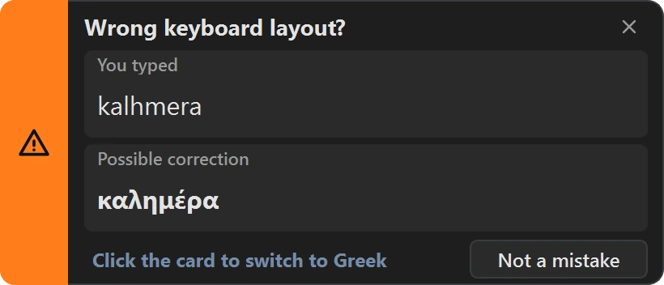
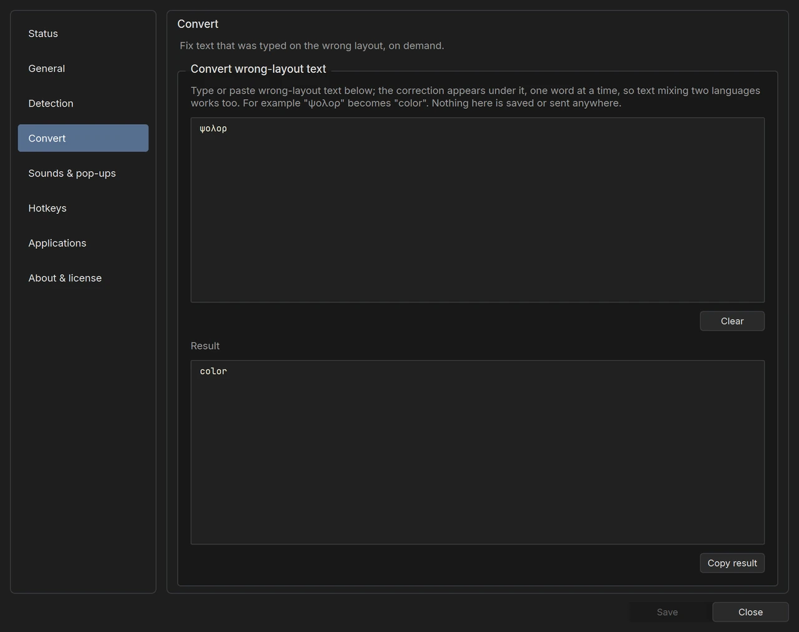
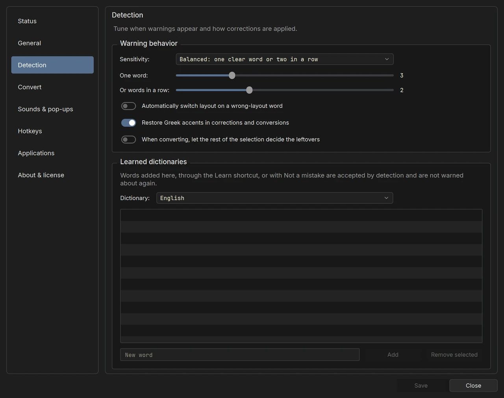
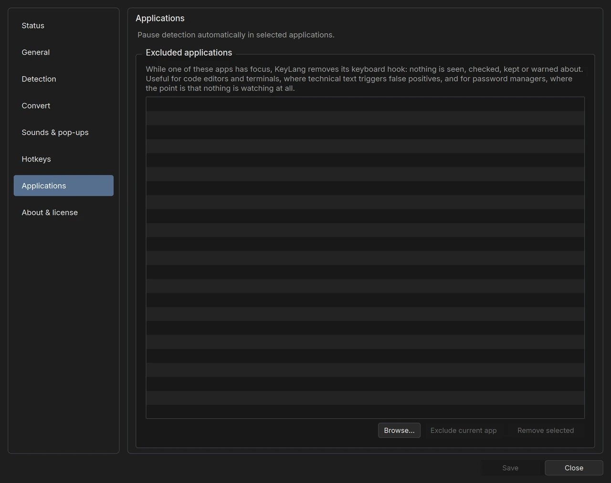

<p align="center">
  
</p>

# oncut KeyLang

**Keyboard layout checker.** You meant `привет` and typed `ghbdtn`.
KeyLang notices after one word, shows you what you meant, and switches the
keyboard layout with a click. It lives in the system tray, and nothing you type
leaves your computer.

**Website and purchase:** <https://apps.oncut.gr/keylang>

> This repository carries KeyLang's releases and its issue tracker. KeyLang is
> proprietary software: the source code is not published here.

https://github.com/user-attachments/assets/3dec753e-5d01-428f-a7e0-8d8bc191367a

## What it does

- **Warns after one word.** Every word you finish is checked, on your
  computer, against built-in word lists for each language. It waits for a whole
  word, so an abbreviation or a password field does not set it off.
- **Switches with one click.** Click the warning and the application you are
  typing in changes layout. *Not a mistake* adds the word to your learned
  words, so KeyLang does not warn about it again.
- **Fixes what you already typed.** Select text and press `Ctrl+Alt+Shift+R` to
  convert and replace it in place, capitals kept and Greek accents restored.
- **Eight languages.** Arabic, French, German, Greek, Hebrew, Russian and
  Ukrainian, each with English, and non-Latin layouts against each other, such as
  Hebrew and Greek. On Windows it also notices a Chinese Pinyin input method
  left on while you type English.
- **Stays out of the way.** No window, only a tray icon. Pause it, switch it off
  in chosen applications, start it when you sign in.
- **Nothing you type leaves your computer.** No telemetry, no crash uploads, no
  automatic updates. What you type is examined in memory and discarded. On
  Windows the license is handled by the separate oncut License Manager, which
  never sees what you type (see [Privacy](#privacy)).

## Examples

One word in each of the eight languages, typed with the wrong layout on:

| Language | You typed | Layout on | You meant |
| --- | --- | --- | --- |
| Arabic | `lvpfh` | English | `مرحبا` |
| English | `руддщ` | Russian | `hello` |
| French | `qvec` | English | `avec` |
| German | `ywei` | English | `zwei` |
| Greek | `kalhmera` | English | `καλημέρα` |
| Hebrew | `akuo` | English | `שלום` |
| Russian | `ghbdtn` | English | `привет` |
| Ukrainian | `ghbdsn` | English | `привіт` |

German and French share most keys with English, so only words that differ on
the keyboard (Y and Z on German; A, Q, Z and W on French) can be told apart.

## Screenshots

<p align="center">
  
</p>

The warning, after one word: click the card and the layout switches.

<p align="center">
  
</p>

Convert: paste text typed on the wrong layout and read it back corrected.

<p align="center">
  
</p>

Detection: how sure KeyLang must be before it warns, and the words you taught
it.

<p align="center">
  
</p>

Applications: KeyLang steps aside in the programs you choose, such as a
password manager.

## Editions

| | Windows 10 and 11 | Linux, X11 and Wayland | macOS |
| --- | --- | --- | --- |
| Price | EUR 9.90, VAT included, one payment | free | not yet |
| Trial | 14 days, same download | not needed | |
| License key | by email within one business day | none | |
| Activation | oncut License Manager, installed with KeyLang | none | |
| Package | installer, signed by oncut | AppImage | |

Buy at <https://apps.oncut.gr/keylang>. Refunds within 14 days of payment, no
questions asked: <https://apps.oncut.gr/refunds>.

## Download

Get the current version from [Releases](../../releases) or from
<https://apps.oncut.gr/keylang>. Both carry the same files with the same
SHA-256 checksums.

- **Windows:** run the installer. It installs for your user account only,
  needs no administrator rights, and asks you to accept the End-User License
  Agreement. The installer and the application are signed by oncut
  (Authenticode).
- **Linux:** make the AppImage executable (`chmod +x oncut_KeyLang-*.AppImage`)
  and run it. In an X11 session it works on any desktop. Under Wayland it works
  on KDE Plasma and GNOME through [Fcitx5](https://fcitx-im.org): Wayland lets
  no ordinary application see what is typed into other windows, but an input
  method can, so a small KeyLang addon loaded into your own Fcitx5 passes the
  keys on. KeyLang offers to set this up at its first start, installs the addon
  in your home folder, and can undo all of it. Other Wayland desktops are not
  supported. On Ubuntu 24.04 an AppImage needs FUSE once:
  `sudo apt install libfuse2t64`.

To check that a file came from oncut, see [Checking a download](#checking-a-download).

## Requirements

- Windows 10 or 11 (64-bit), or Linux x86_64: an X11 session, or Wayland on
  KDE Plasma or GNOME with Fcitx5.
- The keyboard layouts you type in, installed as usual.
- No administrator rights: the Windows installer installs for your user account only.

## Privacy

KeyLang has to see the keys you press to do its job. It checks them in memory
and discards them; it makes no network connections and keeps no record of what
you type.

On Windows, the trial and the license are handled by the oncut License Manager,
a separate app installed with KeyLang. It activates the license with oncut's
activation server and renews the activation about once a day while the computer
is online; KeyLang itself checks the license offline. The License Manager never
receives what you type. What it sends and what the server keeps is in section 4
of the privacy notice. How it works: <https://apps.oncut.gr/license-manager>.
The Linux edition has no license and no License Manager.

The full notice: <https://apps.oncut.gr/privacy>.

## Support

- **Something does not work:** [open an issue](../../issues/new/choose). The
  tracker is public, so please do not paste text you typed, passwords or log
  files.
- **Purchases, license keys, refunds, privacy:** support@oncut.gr.
- **A security problem:** report it privately, as described in the
  [security policy](../../security/policy) and at
  <https://apps.oncut.gr/security>.

## Checking a download

Each release comes with `SHA256SUMS`, signed by oncut with
[minisign](https://jedisct1.github.io/minisign/) in `SHA256SUMS.minisig`. The
public key is published at <https://apps.oncut.gr/keys>. In the folder with the
files:

```sh
minisign -Vm SHA256SUMS -P <public key from apps.oncut.gr/keys>
sha256sum -c --ignore-missing SHA256SUMS
```

Run them in that order. The first proves the checksum list comes from oncut; the
second proves your file matches it. The checksum alone only catches a broken
download.

The release key id is **`3AA1B9E2CD1C2AE8`**. It must match the one on
<https://apps.oncut.gr/keys>: the key and this README reach you by two
different routes, which is what makes the check worth doing.

## License and open-source components

oncut KeyLang is proprietary software, licensed under its
[End-User License Agreement](https://apps.oncut.gr/keylang/eula). It ships with
Qt (LGPL-3.0) and FFmpeg (LGPL-2.1-or-later), dynamically linked and
replaceable; the Linux AppImage also bundles LGPL libraries from Ubuntu 24.04.
Their license texts travel inside every package, and the versions, source
archives and written offers are listed at
<https://apps.oncut.gr/keylang/licenses>.

oncut KeyLang is made by oncut, Athens, Greece. Who we are:
<https://apps.oncut.gr/legal>.
